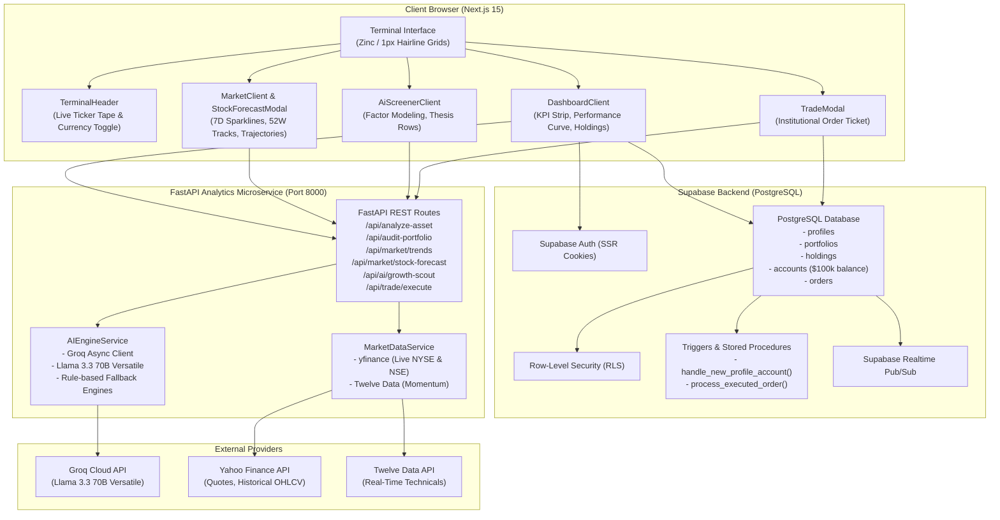

# SimpleInvest — Project Architecture & Complete Technical Documentation

> **SimpleInvest** is an institutional-grade financial intelligence terminal and paper-trading platform engineered for both retail investors and active traders. It translates complex quantitative stock metrics, risk profiles, and macroeconomic stress tests into clear, plain-English insights powered by **Groq LLM (Llama 3.3 70B Versatile)**, **Next.js 15 (App Router)**, **FastAPI**, and **Supabase (PostgreSQL with Row-Level Security)**.

---

## 1. Executive Summary & Purpose

### The Core Problem Solved
Traditional financial platforms fall into two extremes:
1. **Overly Complex Legacy Terminals** (e.g., Bloomberg, FactSet, Interactive Brokers): Filled with dense financial jargon (Beta, Sharpe Ratio, P/E multiples, standard deviation) that intimidates ordinary investors.
2. **Simplified Retail Apps**: Flashy gamified apps that conceal critical portfolio concentration risks, lack real forward-looking scenario modeling, or use generic "AI-slop" template badges.

### The SimpleInvest Solution
SimpleInvest bridges this gap with an authentic **editorial financial terminal aesthetic** (inspired by Linear, Fey, and Robinhood Legend):
- **Zero Jargon**: Real-time translation of quantitative asset metrics into intuitive concepts (e.g., volatility ratings explained as *"Defensive Low Volatility"* vs. *"High Beta Surge"*).
- **Institutional Scannability**: Strict **1px solid hairline grids** (`#1f1f24`), matte carbon background (`#09090b`), monospace tabular numbers (`font-mono tabular-nums`), and sharp architectural corner radii (4px/6px).
- **Forward Trajectory Intelligence**: 30-day Bayesian price prediction bands, key support/resistance boundaries, and macro stress tests (e.g., Rate Shocks, AI Supercycle, Bear Corrections).
- **Risk-Free Execution**: Built-in paper trading engine with automated PostgreSQL balance triggers and an initial $100,000 buying power.

---

## 2. High-Level Project Architecture

The platform uses a modern decoupled architecture:
1. **Frontend Presentation & SSR Layer**: Next.js 15 with React Server Components, TypeScript, Tailwind CSS, Recharts, and Lucide icons.
2. **Backend Microservice & Analytics Engine**: FastAPI (Python 3.11), Pydantic v2 schemas, yfinance, and Twelve Data pipelines.
3. **AI Intelligence Engine**: Groq SDK with Llama 3.3 70B Versatile generating strict JSON outputs.
4. **Data Persistence & Real-Time Sync**: Supabase PostgreSQL with SSR Cookie Auth, Row-Level Security (RLS), and database trigger functions for order processing.

### Architecture Diagram



---

## 3. Subsystem Breakdown ("Inside-Out")

### A. Frontend Design System & Editorial Financial Aesthetic
The frontend has been completely refactored to remove all generic AI-generated template styling (no amber radial glows, no multi-color text gradients, no fake badges, and no giant pill containers):

| Attribute | Old "AI-Slop" Style | Refactored Financial Terminal Aesthetic |
| :--- | :--- | :--- |
| **Canvas Background** | Radial brown/gold gradients on `#000000` | Pure matte carbon `#09090b` (`bg-zinc-950`) |
| **Surface Panels** | Heavy backdrop blurs with glowing yellow borders | Solid `#0f0f12` (`bg-[#0f0f12]`) with `#141418` hover |
| **Hairline Borders** | Glowing gold and green cards | Crisp 1px solid hairline `#1f1f24` (`border-zinc-800/80`) |
| **Typography** | Rainbow gradient headers, standard fonts | Solid `#fafafa` headings (`text-zinc-50`), `font-mono tabular-nums` for all values |
| **Corner Radii** | Giant `rounded-2xl` and floating pills | Sharp architectural `rounded-md` (6px) and `rounded` (4px) |
| **Semantic Accents** | Muddy yellow, bright purple | Crisp white CTA, Emerald (`#34d399`) for buys/gains, Rose (`#fb7185`) for sells/losses |

#### Component Breakdown:
1. **`TerminalHeader.tsx`**:
   - **Top Ticker Tape (`h-8 border-b border-zinc-800/80 bg-zinc-950 px-4`)**: Real-time ticker ribbon featuring `S&P 500`, `NASDAQ`, `NIFTY 50`, `BTC/USD`, `NVDA`, `TSLA`, `RELIANCE.NS`, and `TCS.NS` with clean monospace deltas and a compact `USD / INR` currency toggle.
   - **Main Navigation Bar (`h-13 bg-zinc-950/90 backdrop-blur-md px-6`)**: Minimal monochrome icon, `SimpleInvest` branding, single-line horizontal tabs (`Dashboard`, `Markets`, `Screener`), compact book selector (`BOOK: Default`), and user avatar with sign-out.
2. **`DashboardClient.tsx`**:
   - **Unified KPI Strip**: Replaced floating boxes with a single 4-column hairline grid container (`COMMITTED CAPITAL`, `REAL-TIME VALUATION`, `VOLATILITY RATING`, `DIVERSIFICATION SCORE`).
   - **12-Column Grid Layout**:
     - **Left 8 Columns**:
       - *Portfolio Equity Curve*: Subtle emerald area gradient (`rgba(16, 185, 129, 0.12)` to transparent) with a crisp 1.5px stroke and S&P 500 dashed benchmark overlay.
       - *Holdings Table (`HoldingsTable.tsx`)*: Clean tabular layout, clean percentages (`38.5%`), subtle dot indicators (`● Low`, `● Moderate`, `● High`), and direct low-profile hover `Buy` / `Sell` action buttons that launch the `TradeModal`.
       - *Macro Stress Test (`MarketScenarios.tsx`)*: Compact segmented control (`Base Case`, `Bull Rally`, `Bear Correction`, `Rate Shock`, `Tech Supercycle`) with a 2-column projected valuation comparison row.
     - **Right 4 Columns**:
       - *Sector Exposure (`SectorDonutChart.tsx`)*: Scannable horizontal stacked progress bar + compact legend table displaying exact dollar values and percentages.
       - *AI Equity Research Note (`JargonBusterCard.tsx`)*: Institutional report layout with clean typographic hierarchy: `01 / SUMMARY & ASSET PROFILE`, `02 / CONCENTRATION RISK`, `03 / RECOMMENDED ACTIONS`.
3. **`MarketClient.tsx` & `StockForecastModal.tsx`**:
   - 4-column summary metric strip (`WATCHLIST COVERAGE`, `TOP ADVANCER`, `TOP DECLINER`, `VOLUME LEADER`).
   - High-density table rows (`h-12`) featuring 1.5px SVG sparklines, 2px 52-week range channels with white indicator dots, and ghost `Chart` / `Trade` buttons.
   - Forward Forecast Modal: 4-column metric strip (`30D Projection`, `Bull Target`, `Bear Floor`, `Model Confidence`) with historical and predicted price lines, confidence interval area bands, volume bars, and fundamental catalysts.
4. **`AiScreenerClient.tsx`**:
   - Single-row toolbar combining sector filters, risk profile toggle, and `Run Screener` button.
   - Structured thesis cards with `CATALYST`, `FUNDAMENTAL METRIC`, and `RISK FACTOR` sections, conviction percentages, and direct trade execution buttons.
5. **`TradeModal.tsx`**:
   - Zero-fluff institutional order ticket with segmented BUY/SELL toggle, real-time shares/total value calculations, available buying power display, and execution state handling.

---

### B. Backend Architecture & API Services (FastAPI)

Located in `backend/app/`, the FastAPI service provides low-latency async endpoints for stock valuation, portfolio auditing, forecasting, and trade execution:

```
backend/
├── app/
│   ├── api/
│   │   ├── asset_routes.py       # Single-stock plain-English analysis
│   │   ├── market_routes.py      # Market trends, AI stock forecast, growth scout
│   │   ├── portfolio_routes.py   # Full portfolio audit & risk diagnostic
│   │   └── trading_routes.py     # Paper trading order placement & momentum
│   ├── services/
│   │   ├── ai_engine.py          # Groq SDK client (Llama 3.3 70B Versatile)
│   │   ├── market_data.py        # yfinance pipeline & 52W/sparkline calculations
│   │   └── twelve_data.py        # Twelve Data API client for technicals
│   ├── schemas/                  # Pydantic v2 data models & validation
│   ├── config.py                 # Application settings (GROQ_API_KEY, GROQ_MODEL)
│   ├── db.py                     # Database connection helpers
│   └── main.py                   # FastAPI app entry point & CORS configuration
```

#### Key API Endpoints:
- `POST /api/analyze-asset`: Evaluates single stock metrics (P/E, Beta, 52W range) and returns risk vibes without jargon.
- `POST /api/audit-portfolio`: Audits entire holdings array, calculates sector entropy, diversification score, and actionable takeaways.
- `GET /api/market/trends`: Fetches live NYSE & NSE quotes, 7-day sparkline arrays, and 52-week price channels.
- `POST /api/market/stock-forecast`: Generates Bayesian forward price paths, bull/bear targets, and fundamental catalysts.
- `POST /api/ai/growth-scout`: High-conviction growth opportunities filtered by risk preference and sector.
- `POST /api/trade/execute`: Validates and records paper trade orders against Supabase tables.

#### Groq Model Stability Fix:
- Addressed 404 model errors on `/api/ai/growth-scout` by ensuring model strings are sanitized (`.strip()`, removal of accidental quotes or newlines) and configured to the active production model `"llama-3.3-70b-versatile"` (with fallback to `"llama-3.1-8b-instant"` and local rule-based fallback engines).

---

### C. Database Architecture & Automated Paper Trading (Supabase)

The database layer runs on PostgreSQL with Row-Level Security enabled across all tables:

1. **`public.profiles`**: Extends `auth.users` with user metadata, email, and full name.
2. **`public.portfolios`**: Stores user portfolios (e.g., "Default Portfolio", "Tech Growth").
3. **`public.holdings`**: Tracks active asset positions (`ticker`, `shares`, `average_buy_price`).
4. **`public.accounts`**: Manages paper trading cash balance (initialized to **$100,000.00**).
5. **`public.orders`**: Complete audit log of BUY and SELL orders (`shares`, `price`, `total_value`, `status`).

#### Automated Database Triggers (`trading_schema.sql`):
- **`handle_new_profile_account`**: Automatically runs after `INSERT ON public.profiles` to credit the user with a $100,000 starting cash balance.
- **`process_executed_order`**: Automatically runs after `INSERT ON public.orders`:
  - On **BUY**: Deducts `total_value` from `accounts.balance`, inserts or updates `holdings` recalculating the volume-weighted `average_buy_price`.
  - On **SELL**: Credits `total_value` to `accounts.balance`, deducts `shares` from `holdings`, and removes the holding row if `shares <= 0`.

---

## 4. Summary of Completed Work

1. **Backend Stabilization**:
   - Fixed Groq model 404 error by setting default to active production model `"llama-3.3-70b-versatile"`.
   - Sanitized model strings in `AIEngineService.__init__` and verified `/api/ai/growth-scout` returns clean `200 OK`.
   - Passed all 6 automated pytest test suites in `tests/test_api.py`.
2. **Global Design System Reset (`globals.css` & `layout.tsx`)**:
   - Removed all radial brown/gold background gradients and glowing borders.
   - Established pure matte carbon canvas `#09090b` (`bg-zinc-950`) and panel surfaces `#0f0f12`.
   - Enforced strict 1px hairline borders `#1f1f24` (`border-zinc-800/80`).
   - Enforced `font-mono tabular-nums` for all numerical telemetry and sharp 4px/6px border radii.
3. **Terminal Header & Navigation (`TerminalHeader.tsx` & `Navbar.tsx`)**:
   - Built a 2-tier header: 32px top ticker tape with live indices and USD/INR toggle, and 52px main navigation with single-line links, clean logo, and compact book selector.
4. **Dashboard Refactor (`DashboardClient.tsx` & subcomponents)**:
   - Compact header bar with single-row action buttons (`Export`, `Re-Audit`, `+ Add Position`).
   - Unified 4-cell KPI strip container.
   - 12-column grid layout with 1.5px emerald performance curve.
   - Institutional `HoldingsTable` with hover Buy/Sell triggers.
   - Compact `MarketScenarios` macro stress test.
   - Horizontal stacked `SectorDonutChart`.
   - Equity research note layout for `JargonBusterCard`.
5. **Market Terminal Refactor (`MarketClient.tsx` & `StockForecastModal.tsx`)**:
   - Replaced floating cards with 4-column hairline metric strip.
   - High-density rows with 1.5px sparklines, 2px 52W range tracks, and direct ghost actions.
   - 4-column stat bar inside `StockForecastModal` (`30D Projection`, `Bull Target`, `Bear Floor`, `Confidence`).
6. **AI Screener Refactor (`AiScreenerClient.tsx`)**:
   - Compact single-row filter bar and structured thesis cards with direct `Execute Trade` and `View Trajectory` triggers.
7. **Order Ticket Refactor (`TradeModal.tsx` & `AIInsightDrawer.tsx`)**:
   - Zero-fluff institutional order ticket with segmented BUY/SELL toggle and buying power breakdown.
8. **Auth Pages Refactor (`login/page.tsx` & `signup/page.tsx`)**:
   - Removed all Platinum badges and glow blurs; refactored to clean monochromatic terminal authentication desks.
9. **Verification**:
   - `npx tsc --noEmit`: 0 errors.
   - `pytest tests/ -v`: 6 passed in 11.89s.

---

## 5. Local Setup & Execution Guide

### Prerequisites
- Node.js 18+ & npm
- Python 3.11+
- Git

### 1. Backend Service Setup (FastAPI)
```bash
# Navigate to project root
cd "d:\Fintech Project"

# Install Python dependencies
pip install -r requirements.txt

# Verify .env configuration
# Ensure GROQ_API_KEY is populated and GROQ_MODEL=llama-3.3-70b-versatile

# Start FastAPI server on port 8000
uvicorn backend.app.main:app --reload --port 8000
```

### 2. Frontend Application Setup (Next.js 15)
```bash
# Install frontend dependencies
npm install

# Start development server on port 3000
npm run dev
```

### 3. Running Automated Tests
```bash
# Run backend pytest suite
pytest tests/ -v

# Run TypeScript compilation check
npx tsc --noEmit
```

---

## 6. Git Status & Pending GitHub Action

All code changes have been tested and formatted across the repository. The working tree is staged and ready for commit:
```
Modified files:
  - .env.example
  - backend/app/config.py
  - backend/app/services/ai_engine.py
  - src/app/globals.css
  - src/app/layout.tsx
  - src/app/login/page.tsx
  - src/app/signup/page.tsx
  - src/components/dashboard/AddAssetDialog.tsx
  - src/components/dashboard/DashboardClient.tsx
  - src/components/dashboard/HoldingsTable.tsx
  - src/components/dashboard/JargonBusterCard.tsx
  - src/components/dashboard/MarketScenarios.tsx
  - src/components/dashboard/Navbar.tsx
  - src/components/dashboard/RiskGauge.tsx
  - src/components/dashboard/SectorDonutChart.tsx
  - src/components/market/MarketClient.tsx
  - src/components/market/StockForecastModal.tsx
  - src/components/screener/AiScreenerClient.tsx
  - src/components/trading/AIInsightDrawer.tsx
  - src/components/trading/InteractiveStockChart.tsx
  - src/components/trading/TradeModal.tsx
  - src/components/ui/badge.tsx
  - src/components/ui/button.tsx
  - src/components/ui/card.tsx
  - src/components/ui/dialog.tsx
  - src/components/ui/input.tsx
  - src/components/ui/table.tsx
New files:
  - src/components/terminal/TerminalHeader.tsx
  - PROJECT_DOCUMENTATION.md
  - README.md
```

**As requested by the user, pushing to GitHub will take place immediately upon your approval.**
